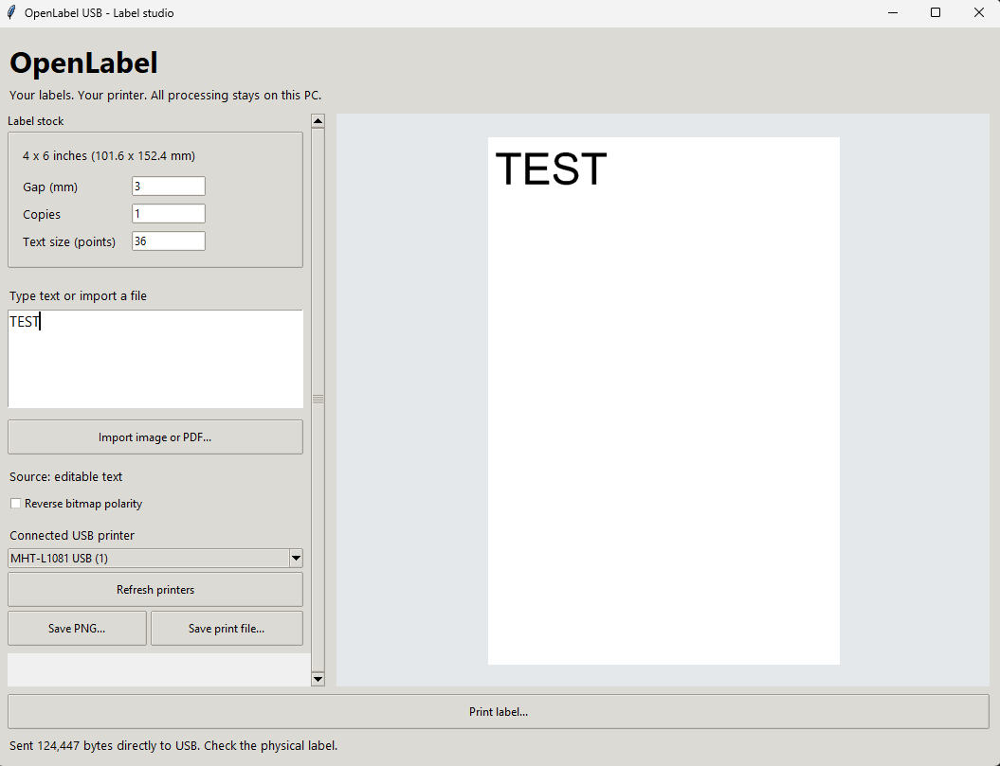

# OpenLabel USB

**An independent, open-source 4 x 6 label app for the MHT-L1081.**

Type a label or import an image/PDF, see a live preview, and print directly over USB. No Milestone label editor or vendor rendering DLL is used.

[Download the preview](https://github.com/Salutatorian/OpenLabel-USB/releases) · [Investigation notes](docs/REVERSE_ENGINEERING.md)



## Why this exists

I wanted to print my own labels without depending on an opaque installer. I did not know what the MHT-L1081 installer was putting on my computer, so I wanted an understandable alternative with source I could inspect.

We used [REA — Reverse Engineer Anything](https://github.com/morluto/rea) to help inspect the supplied **MHT-L1081** software package, supplemented by direct binary inspection, disassembly, and the supplied Linux printer definition. That investigation identified the print-command format and led to this independent implementation. It does **not** establish that the vendor software is malicious or unsafe, and this project makes no such claim.

The owner confirmed a physical Windows test label printed **after uninstalling MHT Label Printer Driver**. Mac builds use an experimental PyUSB/libusb transport; physical Mac printing has not yet been validated.

## Downloads

Choose a file on the [Releases page](https://github.com/Salutatorian/OpenLabel-USB/releases):

| Computer | Download | Validation |
| --- | --- | --- |
| Windows Intel/AMD 64-bit | `OpenLabel-Windows-x64.exe` | Direct USB printing physically verified on one MHT-L1081 |
| Intel Mac | `OpenLabel-macOS-x64.zip` | Native build and packaged launch checked in CI; physical printing unverified |
| Apple silicon Mac (M-series) | `OpenLabel-macOS-arm64.zip` | Native build and packaged launch checked in CI; physical printing unverified |

Mac releases target **macOS 15 or later**. These are Mac desktop apps, **not iPhone or iPad apps**. Downloads are unsigned on Windows and ad-hoc signed, not Apple-notarized, on Mac. macOS may block an unidentified-developer app; inspect the source or build it yourself if you do not trust the download. Disabling security protections is not required or recommended by this project.

Windows: run the `.exe`; no installer is required. Mac: extract the ZIP and open `OpenLabel.app` (you can move it to Applications). The Mac ZIP includes libusb. Compare the downloaded file with `SHA256SUMS.txt` from the release.

## Use

1. Connect and power on an **MHT-L1081 USB printer**, with 4 x 6 labels loaded.
2. Open OpenLabel and select the detected printer. Click **Refresh printers** after reconnecting.
3. Type text or select **Import image or PDF**. The preview updates automatically. Editing text switches back to text mode.
4. Check the preview and copies, then click **Print label** and confirm.

Stock is fixed at **4 x 6 inches (101.6 x 152.4 mm)**. The default gap is 3 mm; match it to your actual stock. Start with one label. The Print button stays at the bottom, settings scroll in small windows, and the preview adapts to the window. PNG and raw `.prn` exports are available.

## Scope and limits

- Investigated model: **MHT-L1081**, observed USB VID/PID `0FE6:811E`, 203 dpi class (8 dots/mm). Discovery checks the model description; it is not tied to the original owner's serial number.
- Other printer models, alternate USB IDs, 300 dpi variants, Bluetooth and Wi-Fi are not supported or claimed compatible.
- PDFs import **page 1 only**. Imports fit inside the label with a small margin. There is no automatic crop or barcode verification.
- This standalone app does **not** add a system printer queue or support browser **Ctrl+P / Cmd+P**. Download an eBay/shipping PDF, then import it here.
- Windows uses Microsoft's built-in USB support. Mac uses libusb. Direct transfers do not appear in the OS print queue. Close other apps using the printer; inspect physical output before retrying a failed or partial transfer.
- Mac USB access can fail if another driver or app owns the interface. A successful build does not establish hardware compatibility. Please report the OS, architecture and error when testing.
- The app does not flash firmware, uninstall software, monitor firmware status, or power the printer. Keep its own power supply connected.
- No telemetry, cloud account or network print service is implemented. Labels are processed locally.

## Build from source

Python 3.12 and Tk support are required. Use a virtual environment:

```sh
python -m venv .venv
# Windows: .venv\Scripts\activate
# Mac: source .venv/bin/activate
python -m pip install -r requirements-build.txt
python -m unittest discover -p "test_*.py"
python openlabel.py
```

Mac source builds also need `brew install libusb`. Build native downloads with `python scripts/build.py`. Build each Mac variant on its matching architecture.

The [release workflow](.github/workflows/release.yml) builds all three variants, runs tests and packaged launch checks, verifies Mac architecture/signing integrity, and publishes assets with SHA-256 checksums. GUI tests open temporary windows but never send labels.

## License and attribution

Public releases use **GNU AGPL-3.0-only**; see [LICENSE](LICENSE). This is compatible with the included PyMuPDF PDF dependency's open-source option. Dependency notices and source links are in [THIRD_PARTY.md](THIRD_PARTY.md).

Thanks to [REA](https://github.com/morluto/rea), Pillow, PyMuPDF, PyUSB, libusb and PyInstaller. REA is an investigation tool, not a bundled runtime dependency. This project is independent of Milestone/MHT and is not endorsed by them. Vendor installers, drivers, firmware and proprietary font files are not redistributed.

## iPad development branch

An experimental native SwiftUI editor and TSPL encoder is being built with xtool on the `ipad-xtool` branch. See [iPad development notes](https://github.com/Salutatorian/OpenLabel-USB/blob/ipad-xtool/ipad/README.md). It now includes a compiled USBDriverKit driver and app-side print transport, but device provisioning and physical iPad printing remain unverified. It is not part of the desktop downloads.
