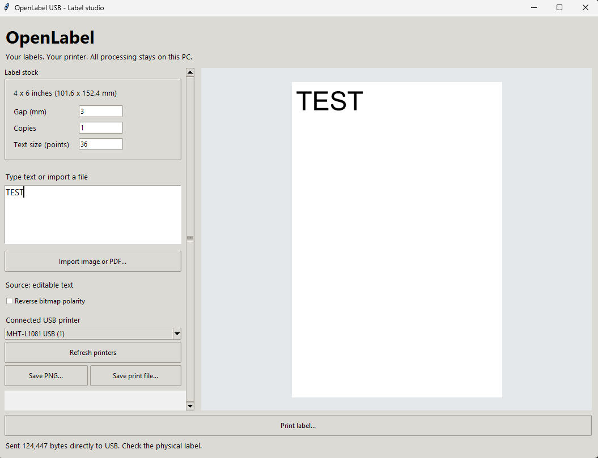

First public preview of **OpenLabel USB**, an independent 4 x 6 label app for the **MHT-L1081**.

- **Windows x64:** direct USB through Windows built-in support. Physical printing confirmed on one unit after uninstalling MHT Label Printer Driver.
- **Intel Mac / Apple silicon Mac:** separate native app ZIPs with bundled libusb. CI builds and launches the packaged apps; **physical Mac printing remains experimental and unverified**.
- Live preview, text labels, image/first-page PDF import, fixed 4 x 6 stock, copies, PNG/raw export, scrollable controls and a pinned Print button.

### Choose your download

- Windows Intel/AMD 64-bit: **OpenLabel-Windows-x64.exe**
- Intel Mac, macOS 15+: **OpenLabel-macOS-x64.zip**
- M-series Mac, macOS 15+: **OpenLabel-macOS-arm64.zip**
- Checksums: **SHA256SUMS.txt**

Unsigned / non-notarized preview downloads. No MHT installer, driver or firmware is bundled. Source and build scripts are public. License: **AGPL-3.0-only**, with separate dependency notices.

### Why it was built

The owner did not know what the MHT-L1081 installer was installing and wanted an app they could inspect and control. We used [REA](https://github.com/morluto/rea) for artifact inspection, supplemented by direct binary inspection and disassembly, to investigate the MHT-L1081 print path. This is not a claim that the vendor installer is unsafe or malicious. [Read the investigation](https://github.com/Salutatorian/OpenLabel-USB/blob/main/docs/REVERSE_ENGINEERING.md).

### Known limits

MHT-L1081 only, 203 dpi class, USB only. PDF page 1 only. No browser Ctrl+P/Cmd+P integration, OS printer queue, iPad/iPhone app, firmware flashing or general printer compatibility. Check the physical result; start with one copy. Mac testers: please report your OS version, architecture and any USB error.

